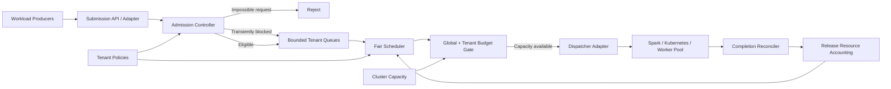

# Multi-Tenant Workload Governor

**A tenant-aware control-plane scheduling core for shared data and compute platforms.**

The Multi-Tenant Workload Governor (MTWG) decides whether a workload can enter a shared execution environment, when it should run, and which tenant budgets it is allowed to consume. It is designed as a reusable control-plane component for ingestion, Spark jobs, Iceberg maintenance, report generation, and other asynchronous workloads.

> **Status:** Reference implementation / engineering portfolio project. The scheduling core is executable and intentionally framework-independent. It is not yet a distributed, durable production control plane.

## Why this problem matters

In a firm-wide platform, hundreds of applications may submit work to a finite pool of compute. Per-application throttling is insufficient: independent applications can collectively overload a shared cluster, noisy tenants can monopolize capacity, and high-priority work can starve lower-priority work indefinitely.

MTWG separates **admission**, **queueing**, **fair dispatch**, and **execution lifecycle accounting**. The core has no dependency on a specific compute engine or cloud provider.

## Design goals

- Enforce tenant-level CPU, memory, and concurrency budgets.
- Enforce global cluster capacity before dispatch.
- Reject requests that can never fit rather than queueing them forever.
- Queue transiently inadmissible work with bounded queue capacity.
- Provide weighted fairness across tenants within priority classes.
- Apply bounded priority aging to reduce starvation.
- Release accounting exactly once on completion or cancellation.
- Explain every admission and dispatch decision.
- Keep scheduling policy independent of Spark, Kubernetes, Redis, and HTTP.

## Current capabilities

| Capability | Implementation |
|---|---|
| Admission control | Static request validation + current budget/capacity checks |
| Tenant isolation | Per-tenant CPU, memory, and concurrency budgets |
| Global protection | Cluster CPU, memory, and running-workload limits |
| Weighted fairness | Virtual finish-time ordering within effective priority |
| Priority aging | Configurable aging interval and maximum boost |
| Backpressure | Global bounded pending queue |
| Lifecycle accounting | Start, complete, cancel, capacity update |
| Explainability | Structured decision reason and scheduler snapshot |
| Testability | Pure Java core with deterministic clock injection |

## Explicit non-goals in this iteration

- Durable queue/state recovery after process restart.
- Multi-replica consensus or distributed locking.
- Kubernetes/Spark submission and reconciliation.
- Preemption of running workloads.
- Predictive autoscaling or ML-based scheduling.
- Multi-dimensional placement across heterogeneous clusters.
- Exactly-once external execution. The core governs accounting; adapters must reconcile external job state.

These are deliberate boundaries, not implied capabilities.

## Architecture at a glance



## Repository structure

```text
multi-tenant-workload-governor/
├── src/
│   ├── main/java/io/github/tushar886/governor/
│   │   ├── api/              # Public request/decision contracts
│   │   ├── domain/           # Immutable domain types and invariants
│   │   ├── policy/           # Tenant policy and policy lookup
│   │   ├── admission/        # Static and dynamic admission decisions
│   │   ├── scheduling/      # Fair scheduling and priority aging
│   │   ├── accounting/      # Capacity and tenant usage accounting
│   │   └── core/            # Orchestration and lifecycle transitions
│   └── test/java/...        # Deterministic unit and concurrency tests
├── docs/
│   ├── architecture/
│   ├── design/
│   ├── operations/
│   └── adr/
└── examples/
```

## Quick start

Requires JDK 21 and Maven 3.9+.

```bash
mvn clean test
```

A small executable example is provided in `examples/`. The public API is intentionally small:

1. Register a tenant policy.
2. Submit a workload.
3. Ask the governor to dispatch eligible work.
4. Mark the external execution as started.
5. Complete or cancel it to release its reservation.

See [Quick Start](docs/operations/quick-start.md) and [Architecture](docs/architecture/overview.md).

## Key design decisions

- **Framework-independent core:** HTTP, persistence, metrics, and executor adapters must not leak into scheduling policy.
- **Reservation at dispatch:** queued work does not consume running capacity. A reservation is acquired atomically when the core starts a workload.
- **No silent overcommit:** global and tenant budgets are checked under one state lock in this in-memory implementation.
- **Weighted fairness is not a hard SLA:** weights influence ordering; they do not guarantee completion deadlines.
- **Priority aging is bounded:** aging improves liveness but cannot override hard tenant or cluster constraints.

See [ADRs](docs/adr/).

## Engineering limitations and next steps

The current implementation is a single-process reference engine. A production deployment should externalize state to a transactional store, use an outbox for dispatch, make executor submission idempotent, reconcile orphaned reservations, and define a leader/partition ownership model. See [Production Evolution](docs/architecture/production-evolution.md).

## Author

Tushar Srivastava
