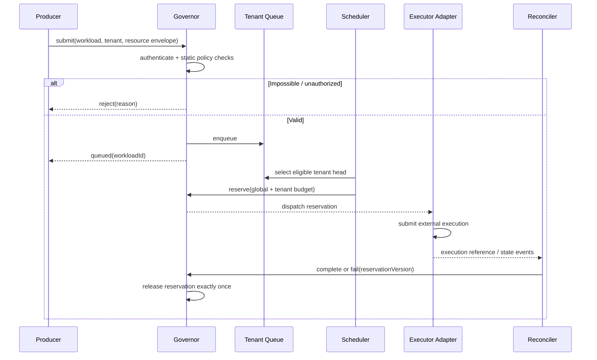

# Control Plane Design

## Control-plane components

| Component | Responsibility | Consistency requirement |
|---|---|---|
| Policy service | Tenant limits, weights, priority entitlements | Versioned, auditable |
| Admission API | Validate and enqueue submissions | Idempotent per tenant/workload |
| Queue manager | Maintain tenant pending work | Durable in production |
| Scheduler | Select eligible work | Single-writer per scheduling partition |
| Reservation ledger | Track reserved resources | Transactional with dispatch intent |
| Dispatcher | Submit to execution backend | Idempotent external request |
| Reconciler | Match external state to internal state | At-least-once events tolerated |
| Telemetry | Queue age, fairness, utilization, rejection | Low-cardinality metrics |

## Request lifecycle

## Multi-tenancy model

Tenant identity is a security boundary, not a caller-controlled scheduling hint. The API adapter must derive tenant identity from authenticated claims or a trusted service identity. The current core accepts a tenant ID in the request for testability; a production adapter must not trust an arbitrary client-supplied value.

Each tenant has:
- CPU and memory ceilings.
- Maximum concurrently running workloads.
- Maximum pending queue depth.
- Relative scheduling weight.
- Maximum authorized priority class.

Hard quotas protect the platform. Weight influences relative share only when multiple tenants compete. A weight of 4 does not grant four times the hard quota.

## Failure boundaries

- If the API process fails before enqueue commit, the caller retries with the same idempotency key.
- If the scheduler fails after reservation but before executor submission, a durable dispatch intent must be retried.
- If executor submission succeeds but the response is lost, the adapter must query by deterministic external idempotency token before retrying.
- If completion notification is lost, reconciliation must discover terminal external state and release the reservation.
- If a worker disappears, lease expiry and reconciliation—not blind accounting reset—must recover capacity.
