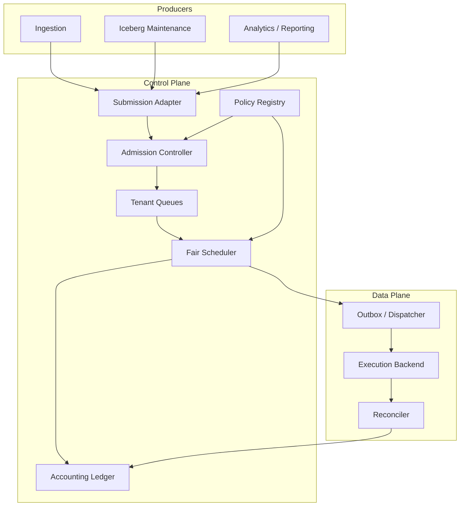

# Architecture Overview

## System context

MTWG sits between workload producers and execution backends. Producers express intent and resource envelopes; the governor enforces platform policy and returns a dispatch reservation. It does not execute the workload.

## Responsibility boundaries

- **Submission adapter:** authentication, request parsing, idempotency key extraction.
- **Admission controller:** validates tenant identity, authorization, static feasibility, and queue limits.
- **Policy registry:** supplies versioned tenant entitlements.
- **Tenant queues:** preserve per-tenant ordering and isolate queue pressure.
- **Fair scheduler:** chooses eligible work across tenants.
- **Accounting ledger:** reserves and releases resources.
- **Dispatcher:** translates reservations into Spark/Kubernetes submissions.
- **Reconciler:** handles success, failure, timeout, cancellation, and orphan recovery.

## Core invariants

1. A workload ID is unique within a tenant for the retention period of its idempotency record.
2. A request larger than either its tenant ceiling or cluster envelope is rejected, not queued.
3. A queued workload consumes no running resource reservation.
4. A running workload owns exactly one reservation version.
5. Completion/cancellation releases that reservation at most once.
6. Dispatch is allowed only when both global and tenant budgets remain within limits.
7. External calls are never made while holding the scheduler state lock.

## Control-plane / data-plane separation

The governor is control-plane logic. Spark executors, Kubernetes pods, and data movement are data-plane concerns. This separation allows the same policy engine to govern different execution backends and avoids coupling scheduling correctness to a particular engine's API.
